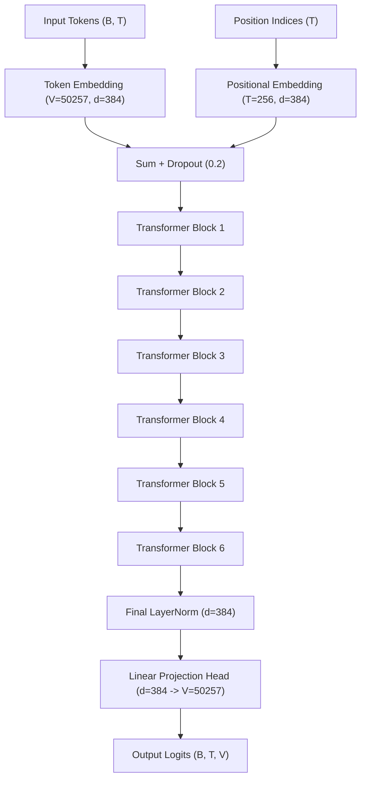
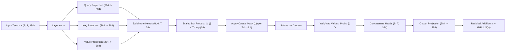

# LLM From Scratch: Architecture and Implementation Guide

A modular, ground-up implementation of a decoder-only generative transformer language model in PyTorch. The project covers data ingestion, Byte-Pair Encoding tokenization, multi-head causal attention, pre-layer normalization transformer blocks, autoregressive pretraining, sampling strategies, and an interactive Streamlit inference interface.

---

## Table of Contents

1. [Architectural Overview](#architectural-overview)
2. [End-to-End Pipeline Dataflow](#end-to-end-pipeline-dataflow)
3. [Component-Level Architecture](#component-level-architecture)
   - [Token and Positional Embeddings](#1-token-and-positional-embeddings)
   - [Causal Multi-Head Self-Attention](#2-causal-multi-head-self-attention)
   - [Position-Wise Feed-Forward Network](#3-position-wise-feed-forward-network)
   - [Pre-Layer Normalization and Residual Connections](#4-pre-layer-normalization-and-residual-connections)
   - [Language Modeling Head and Output Logits](#5-language-modeling-head-and-output-logits)
4. [Exact Parameter Accounting](#exact-parameter-accounting)
5. [Pretraining Configuration and Training Objective](#pretraining-configuration-and-training-objective)
6. [Decoding and Generation Strategies](#decoding-and-generation-strategies)
   - [Greedy Search](#1-greedy-search)
   - [Top-K with Temperature Sampling](#2-top-k-with-temperature-sampling)
7. [Repository File Structure](#repository-file-structure)
8. [Setup and Execution](#setup-and-execution)
   - [Environment Installation](#1-environment-installation)
   - [Running the Streamlit Web Application](#2-running-the-streamlit-web-application)
   - [Programmatic Inference](#3-programmatic-inference)
9. [References](#references)

---

## Architectural Overview

The model follows the generative decoder-only transformer design popularized by GPT-2. It processes input token sequences autoregressively to predict the next token probability distribution over a 50,257-token vocabulary.

### Core Architecture Specifications

| Attribute | Specification | Description |
| :--- | :--- | :--- |
| Model Type | Autoregressive Decoder | Causal language model predicting next token |
| Total Parameters | 50,221,056 (50.2M) | Exact count across all weight tensors |
| Vocabulary Size ($V$) | 50,257 | GPT-2 Byte-Pair Encoding (BPE) tokenizer |
| Context Window ($T$) | 256 tokens | Sequence length during training and evaluation |
| Embedding Dimension ($d$) | 384 | Latent token representation width |
| Transformer Layers ($N$) | 6 | Stacked identical transformer blocks |
| Attention Heads ($h$) | 6 | Parallel self-attention heads per layer |
| Head Dimension ($d_k$) | 64 | Dimension per individual head ($d / h = 384 / 6$) |
| Feed-Forward Expansion | 4x (1,536) | Intermediate projection dimension in MLP |
| Activation Function | GeLU (tanh approx) | Gaussian Error Linear Unit |
| Normalization Scheme | Pre-LayerNorm | LayerNorm preceding multi-head attention and MLP |
| Causal Mask | Upper Triangular ($-\infty$) | Restricts attention to past and current tokens |
| Dropout Rate | 0.20 | Applied to embeddings, attention weights, and residual drops |

---

## End-to-End Pipeline Dataflow



---

## Component-Level Architecture

### 1. Token and Positional Embeddings

Every input token index $t_i \in \{0, 1, \dots, V-1\}$ is mapped to a continuous dense vector via an embedding lookup matrix:

$$\mathbf{E}_{\text{tok}} \in \mathbb{R}^{V \times d} = \mathbb{R}^{50257 \times 384}$$

Because self-attention operations are permutation-equivariant, absolute positional embeddings $\mathbf{E}_{\text{pos}}$ are added to preserve token ordering:

$$\mathbf{E}_{\text{pos}} \in \mathbb{R}^{T_{\text{max}} \times d} = \mathbb{R}^{256 \times 384}$$

For a batch of sequence length $T \le 256$:

$$\mathbf{x}_0 = \text{Dropout}\left(\mathbf{E}_{\text{tok}}[t_{1:T}] + \mathbf{E}_{\text{pos}}[0:T-1]\right) \in \mathbb{R}^{B \times T \times 384}$$

---

### 2. Causal Multi-Head Self-Attention

Each transformer layer contains a multi-head self-attention module. The input $\mathbf{x}$ is projected into Query ($\mathbf{Q}$), Key ($\mathbf{K}$), and Value ($\mathbf{V}$) representations:

$$\mathbf{Q} = \mathbf{x} \mathbf{W}_Q, \quad \mathbf{K} = \mathbf{x} \mathbf{W}_K, \quad \mathbf{V} = \mathbf{x} \mathbf{W}_V$$

Where $\mathbf{W}_Q, \mathbf{W}_K, \mathbf{W}_V \in \mathbb{R}^{d \times d} = \mathbb{R}^{384 \times 384}$. The projections are split into $h = 6$ independent heads, each operating over dimension $d_k = 64$.

#### Causal Attention Computation
For each head $i \in \{1, \dots, 6\}$:

$$\mathbf{A}_i = \text{softmax}\left(\frac{\mathbf{Q}_i \mathbf{K}_i^T}{\sqrt{d_k}} + \mathbf{M}\right) \mathbf{V}_i$$

Where $\mathbf{M}$ is the upper-triangular causal attention mask:

$$M_{j, k} = \begin{cases} 0 & \text{if } j \ge k \\ -\infty & \text{if } j < k \end{cases}$$

Adding $-\infty$ drives future token positions to $0$ post-softmax, preventing tokens from attending to subsequent tokens in the sequence.

The heads are concatenated and projected through an output linear transformation:

$$\text{MHA}(\mathbf{x}) = \left(\text{Concat}(\mathbf{A}_1, \dots, \mathbf{A}_h)\right) \mathbf{W}_O$$



---

### 3. Position-Wise Feed-Forward Network

Following attention, representations pass through a two-layer multi-layer perceptron (MLP) with a $4\times$ hidden expansion factor ($384 \rightarrow 1536 \rightarrow 384$):

$$\text{FFN}(\mathbf{x}) = \left(\text{GELU}\left(\mathbf{x} \mathbf{W}_1 + \mathbf{b}_1\right)\right) \mathbf{W}_2 + \mathbf{b}_2$$

Where:
- $\mathbf{W}_1 \in \mathbb{R}^{384 \times 1536}, \quad \mathbf{b}_1 \in \mathbb{R}^{1536}$
- $\mathbf{W}_2 \in \mathbb{R}^{1536 \times 384}, \quad \mathbf{b}_2 \in \mathbb{R}^{384}$

#### GELU Activation Function (Tanh Approximation)
The Gaussian Error Linear Unit allows probabilistic regularization during activation:

$$\text{GELU}(x) = 0.5 \cdot x \cdot \left(1 + \tanh\left(\sqrt{\frac{2}{\pi}} \left(x + 0.044715 \cdot x^3\right)\right)\right)$$

---

### 4. Pre-Layer Normalization and Residual Connections

The network uses pre-layer normalization (Pre-LN), normalizing input tensors before the sub-layers rather than after them. This stabilizes gradient propagation and allows deeper architectures to train without warm-up instability:

$$\mathbf{x}^{(l)}_{\text{mid}} = \mathbf{x}^{(l-1)} + \text{Dropout}\left(\text{MHA}\left(\text{LayerNorm}_1\left(\mathbf{x}^{(l-1)}\right)\right)\right)$$

$$\mathbf{x}^{(l)} = \mathbf{x}^{(l)}_{\text{mid}} + \text{Dropout}\left(\text{FFN}\left(\text{LayerNorm}_2\left(\mathbf{x}^{(l)}_{\text{mid}}\right)\right)\right)$$

Where Layer Normalization computes:

$$\text{LayerNorm}(\mathbf{x}) = \frac{\mathbf{x} - \mu}{\sqrt{\sigma^2 + \epsilon}} \odot \boldsymbol{\gamma} + \boldsymbol{\beta}, \quad \epsilon = 10^{-5}$$

---

### 5. Language Modeling Head and Output Logits

After the final transformer block, a concluding LayerNorm is applied before mapping representations to unnormalized vocabulary logits:

$$\mathbf{z} = \text{LayerNorm}_{\text{final}}\left(\mathbf{x}^{(N)}\right) \in \mathbb{R}^{B \times T \times 384}$$

$$\mathbf{L} = \mathbf{z} \mathbf{W}_{\text{head}} \in \mathbb{R}^{B \times T \times 50257}$$

Where $\mathbf{W}_{\text{head}} \in \mathbb{R}^{384 \times 50257}$ (no bias). The probability distribution over the vocabulary for the next token is given by:

$$P(t_{i+1} = v \mid t_{1:i}) = \frac{\exp(L_{i, v})}{\sum_{v'=1}^{V} \exp(L_{i, v'})}$$

---

## Exact Parameter Accounting

The table below breaks down every trainable tensor in the 50,221,056-parameter architecture:

| Submodule | Tensor Name | Tensor Shape | Parameter Count |
| :--- | :--- | :--- | :--- |
| **Token Embedding** | `tok_emb.weight` | `[50257, 384]` | 19,298,688 |
| **Positional Embedding** | `pos_emb.weight` | `[256, 384]` | 98,304 |
| **Transformer Block (x6)** | | | |
| - Attention In-Projection | `multihead_attn.in_proj_weight` | `[1152, 384]` | 442,368 |
| - Attention Out-Projection | `multihead_attn.out_proj.weight` | `[384, 384]` | 147,456 |
| - Additional Projection Weight | `proj.weight` | `[384, 384]` | 147,456 |
| - Additional Projection Bias | `proj.bias` | `[384]` | 384 |
| - FeedForward Up-Projection | `ff.layers.0.weight` | `[1536, 384]` | 589,824 |
| - FeedForward Up-Bias | `ff.layers.0.bias` | `[1536]` | 1,536 |
| - FeedForward Down-Projection | `ff.layers.2.weight` | `[384, 1536]` | 589,824 |
| - FeedForward Down-Bias | `ff.layers.2.bias` | `[384]` | 384 |
| - LayerNorm 1 (Weight + Bias) | `norm1.weight`, `norm1.bias` | `[384]`, `[384]` | 768 |
| - LayerNorm 2 (Weight + Bias) | `norm2.weight`, `norm2.bias` | `[384]`, `[384]` | 768 |
| *Subtotal per Block* | | | *1,920,576* |
| *Subtotal for 6 Blocks* | | | **11,523,456** |
| **Final LayerNorm** | `final_norm.weight`, `final_norm.bias` | `[384]`, `[384]` | 768 |
| **Output LM Head** | `out_head.weight` | `[50257, 384]` | 19,298,688 |
| **Total Model Parameters** | | | **50,221,056** |

---

## Pretraining Configuration and Training Objective

The model was pretrained on the Shakespeare corpus (`data/input.txt`, 1,115,394 characters, ~338,025 tokens) with the following training setup:

| Hyperparameter | Value | Description |
| :--- | :--- | :--- |
| Batch Size | 8 | Sequences processed in parallel per optimization step |
| Context Length | 256 | Length of each chunked input sequence |
| Stride | 128 | Overlapping step size for dataset windowing |
| Epochs | 10 | Complete passes over training tokens |
| Optimizer | AdamW | Decoupled weight decay regularization |
| Learning Rate ($\alpha$) | $3 \times 10^{-4}$ | Peak learning rate |
| Weight Decay ($\lambda$) | 0.1 | Regularization term on weights |
| Loss Function | Cross-Entropy | Next-token prediction loss over 50,257 classes |
| Train/Val Split | 90% / 10% | Partitioning of dataset tokens |
| Evaluation Frequency | Every 50 iterations | Periodic loss calculation on validation set |
| Saved Checkpoint | `models/final_pretrained_model.pth` | Serialized model state dict (603 MB) |

### Objective Function

Given a sequence of token IDs $(t_1, t_2, \dots, t_T)$, the model minimizes negative log-likelihood:

$$\mathcal{L}_{\text{CE}} = -\frac{1}{T} \sum_{i=1}^{T} \log P_{\theta}(t_i \mid t_1, \dots, t_{i-1})$$

Target tokens are aligned by shifting input sequences forward by one token index ($t_i \rightarrow t_{i+1}$).

---

## Decoding and Generation Strategies

During inference, autoregressive generation appends predicted tokens step-by-step:

### 1. Greedy Search
At each step, greedy decoding selects the token index with the maximum unnormalized logit (argmax):

$$\hat{t}_{i+1} = \arg\max_{v} \left(L_{i, v}\right)$$

- **Characteristics:** Deterministic, reproducible, fast.
- **Drawbacks:** Susceptible to repetitive loops and degenerate sequences.

### 2. Top-K with Temperature Sampling
Stochastic sampling controls diversity and creativity via two combined mechanisms:

1. **Top-K Filtering:** Restricts candidate vocabulary to only the $K$ tokens with the highest logits:

   $$\mathcal{V}^{(K)} = \text{TopK}(\mathbf{L}_i, K)$$

   All tokens outside $\mathcal{V}^{(K)}$ are set to $-\infty$:

   $$L'_{i, v} = \begin{cases} L_{i, v} & \text{if } v \in \mathcal{V}^{(K)} \\ -\infty & \text{otherwise} \end{cases}$$

2. **Temperature Scaling ($T_{\text{temp}}$):** Modulates the entropy of the probability distribution:

   $$\tilde{L}_{i, v} = \frac{L'_{i, v} - \max_{u}(L'_{i, u})}{T_{\text{temp}}}$$

   $$P(t_{i+1} = v) = \frac{\exp(\tilde{L}_{i, v})}{\sum_{v' \in \mathcal{V}^{(K)}} \exp(\tilde{L}_{i, v'})}$$

   A token is sampled from the resulting categorical distribution:

   $$\hat{t}_{i+1} \sim \text{Categorical}(P(t_{i+1}))$$

- **Lower Temperature ($T < 1.0$):** Sharpens distribution, favoring high-confidence tokens.
- **Higher Temperature ($T > 1.0$):** Flattens distribution, increasing lexical diversity.
- **Top-K Bound ($K \in [1, 100]$):** Eliminates low-probability noise from the long-tail distribution.

---

## Repository File Structure

```
LLMFromScratch/
├── data/
│   ├── input.txt                          # Pretraining text corpus (Shakespeare)
│   └── the-verdict.txt                    # Reference evaluation literature
├── models/
│   └── final_pretrained_model.pth         # 50.2M parameter serialized weights
├── notebooks/
│   ├── 1.WorkingWithTextData.ipynb        # Tokenization and DataLoader design
│   └── 2.AttentionMechanism.ipynb         # Self-attention, causal masking, MHA
├── src/
│   └── llmfromscratch/
│       ├── __init__.py                    # Package initialization
│       ├── DatasetDataLoader.py           # PyTorch Dataset and DataLoader pipelines
│       ├── LLMArchitecture.py            # TransformerBlock, FeedForward, and LLM modules
│       ├── MultiHeadedAttention.py        # Causal MultiHeadAttention implementation
│       ├── Pretraining.ipynb              # Pretraining notebook with AdamW loop
│       └── Textgeneration.py              # Greedy and Top-K sampling routines
├── app.py                                 # Professional Streamlit inference interface
├── pyproject.toml                         # Project metadata and dependencies
├── r.txt                                  # Dependency specifications
└── README.md                              # Technical architectural documentation
```

---

## Setup and Execution

### 1. Environment Installation

Ensure Python 3.10+ (or Python 3.14 via `uv`) is available.

Using `uv` (recommended):

```bash
uv sync
```

Alternatively, using standard `pip`:

```bash
python -m venv .venv
.venv\Scripts\activate      # Windows
# source .venv/bin/activate  # Linux / macOS
pip install -r r.txt
pip install streamlit
```

### 2. Running the Streamlit Web Application

Launch the interactive interface from the project root:

```bash
uv run streamlit run app.py
```

Or via direct virtual environment binary:

```powershell
.venv\Scripts\streamlit run app.py
```

The application provides:
- Selection between Greedy Approach and Top-K + Temperature Sampling.
- Interactive sliders for Temperature ($0.1$ to $2.0$), Top-K ($1$ to $100$), and Max Tokens ($10$ to $300$).
- Real-time token streaming to prevent interface freezing.
- Generation metrics: prompt tokens, generated tokens, total tokens, latency, and tokens/second.
- Token ID inspection and architectural specification tables.

### 3. Programmatic Inference

To generate text directly using Python:

```python
from pathlib import Path
import tiktoken
import torch
from llmfromscratch.LLMArchitecture import LLM
from llmfromscratch.Textgeneration import generate_text, text_to_token_ids, token_ids_to_text

# Define model architecture configuration
CONFIG = {
    "vocab_size": 50257,
    "context_length": 256,
    "emb_dim": 384,
    "n_heads": 6,
    "n_layers": 6,
    "drop_rate": 0.2,
    "qkv_bias": False,
}

device = "cuda" if torch.cuda.is_available() else "cpu"

# Instantiate and load model
model = LLM(CONFIG)
checkpoint = torch.load("models/final_pretrained_model.pth", map_location=device, weights_only=True)
state_dict = checkpoint["model_state_dict"] if "model_state_dict" in checkpoint else checkpoint
model.load_state_dict(state_dict)
model.to(device)
model.eval()

tokenizer = tiktoken.get_encoding("gpt2")
prompt = "First Citizen:"
encoded = text_to_token_ids(prompt, tokenizer).to(device)

# Top-K + Temperature generation
output_ids = generate_text(
    model=model,
    idx=encoded,
    max_new_tokens=100,
    context_size=CONFIG["context_length"],
    temperature=0.8,
    top_k=40,
)

print(token_ids_to_text(output_ids, tokenizer))
```

---

## References

1. Raschka, Sebastian. *Build a Large Language Model (From Scratch)*. Manning Publications, 2024. [GitHub Repository](https://github.com/rasbt/LLMs-from-scratch)
2. Vaswani, Ashish, et al. "Attention Is All You Need." *Advances in Neural Information Processing Systems* 30 (2017).
3. Radford, Alec, et al. "Language Models are Unsupervised Multitask Learners." OpenAI Technical Report (2019).
